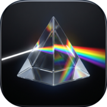
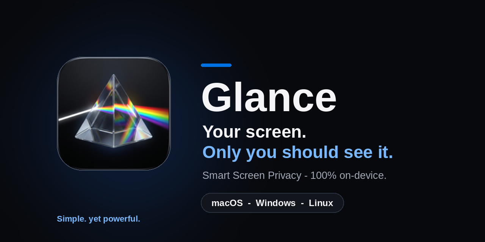
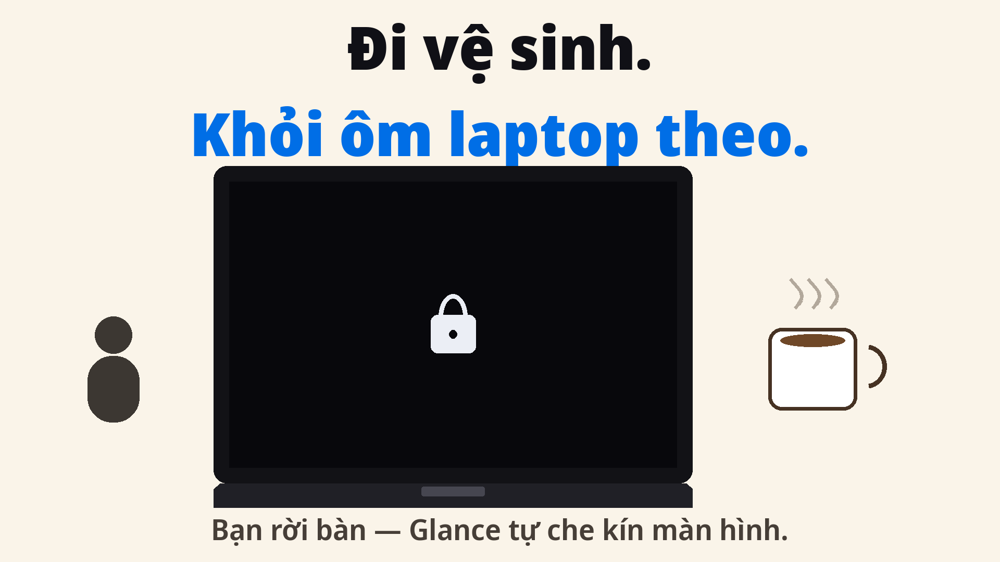
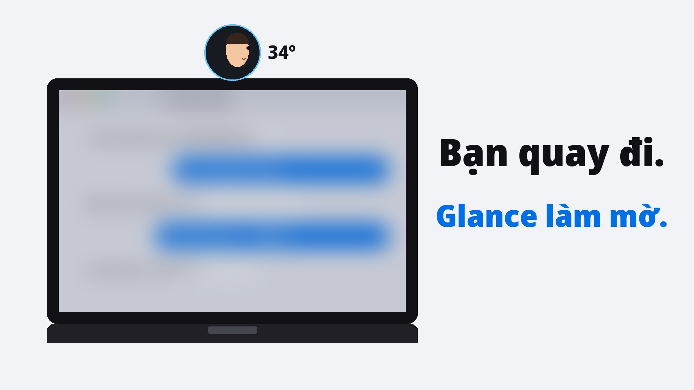
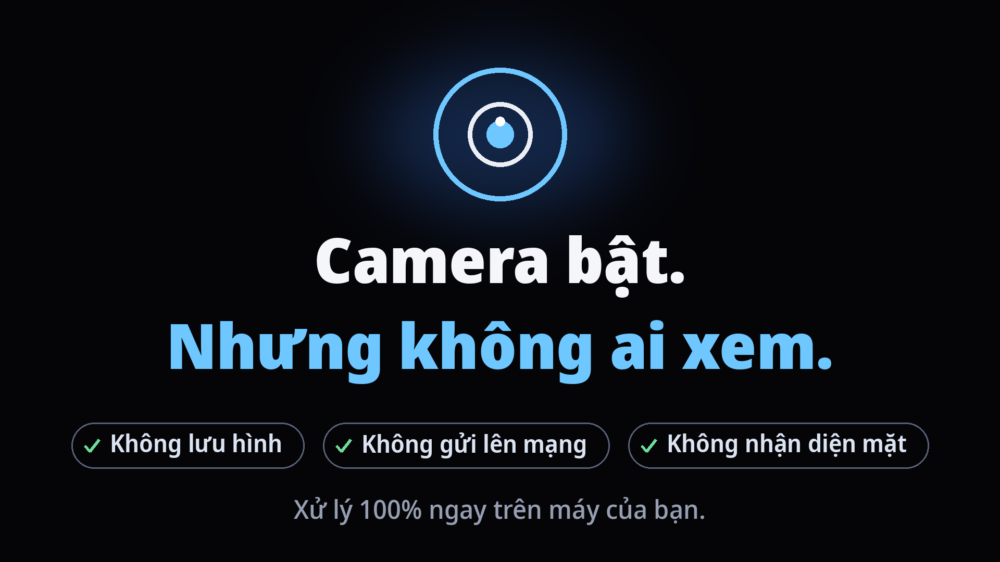
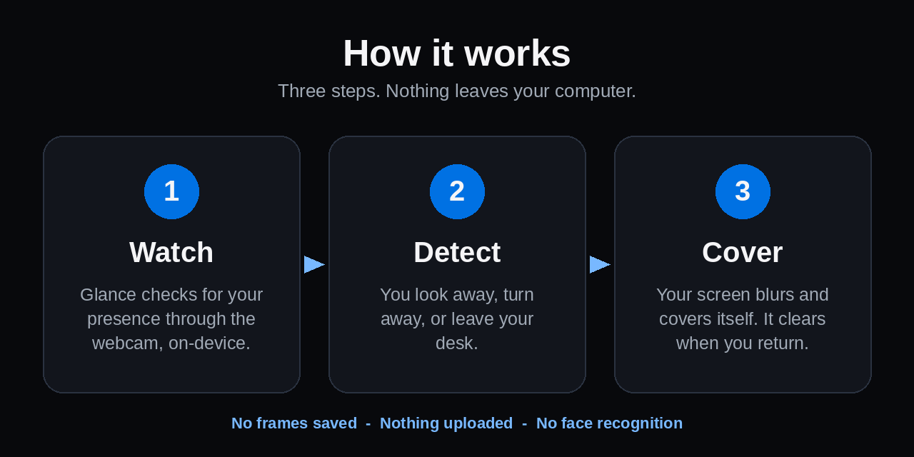

<p align="center">
  
</p>

<h1 align="center">Glance</h1>

<p align="center">
  <strong>Your screen. Only you should see it.</strong><br>
  Glance is a Smart Screen Privacy app that blurs and covers your screen the moment you look away or leave your desk — using your webcam, processed 100% on-device.
</p>

<p align="center">
  
  
  
  
</p>

<p align="center">
  
</p>

<p align="center"><em>Simple. yet powerful.</em></p>

---

## Why Glance?

Your screen is open in cafes, open offices, airports, and meeting rooms.
Anyone standing behind you can read your messages, your code, and your accounts.
Glance covers your screen automatically — so you do not have to remember to.

> **Status, honestly:** macOS is the most complete platform today. Windows and Linux are source-available and still being verified on real hardware. Posture Guard (below) is in active development and is **not yet in a stable release**. Current automated tests: **Windows — 28 passing, Linux — 19 passing** (posture / guard / screen-cover).

## See it

**You leave your desk at a cafe — Glance covers the screen for you.**



**You look away — Glance blurs the screen.**



**The camera is on — but nobody is watching. Processing stays on your machine.**



*Note: the demo visuals above are from the Vietnamese product videos; the app behaviour they show is the same in every language.*

## Features

| Feature | macOS | Windows | Linux |
| --- | :---: | :---: | :---: |
| Auto blur / cover when you look away or leave | ✅ | ✅ | ✅ |
| 100% on-device processing — nothing uploaded | ✅ | ✅ | ✅ |
| No frames saved, no face recognition | ✅ | ✅ | ✅ |
| Turning Glance off truly turns the camera off | ✅ | ✅ | ✅ |
| Camera busy in a meeting? Glance waits, then resumes | ✅ | ✅ | ✅ |
| Camera covered or too dark? Stays still, no false cover | ✅ | ✅ | ✅ |
| “Show screen for 2 minutes” share mode | ✅ (⌥⇧S) | — | — |
| Menu-bar app, native Swift 6 + Vision + CoreMotion | ✅ | — | — |
| AirPods motion support | ✅ | — | — |
| Python + OpenCV implementation | — | ✅ (Win32) | ✅ (PyQt6) |
| Posture Guard (in development, off by default) | 🚧 | 🚧 | 🚧 |

## How it works

<p align="center">
  
</p>

1. **Watch** — Glance checks for your presence through the webcam. All processing happens on your device.
2. **Detect** — You look away, turn away, or step away from your desk.
3. **Cover** — Your screen blurs and covers itself. When you come back, it clears.

That is the whole idea. No account. No cloud. No extra hardware stuck on your screen.

## Privacy

A privacy app must be private itself. Glance is built that way:

- **On-device only.** Presence detection runs locally on your computer.
- **No frames saved.** Webcam frames are processed in memory and discarded.
- **Nothing uploaded.** There is no server receiving your images.
- **No face recognition. No identity verification.** Glance checks *presence*, not *who you are*.
- **Off means off.** Turning Glance off truly turns the camera off.
- **It respects your calls.** If your camera is busy with a meeting call, Glance waits and resumes afterwards.
- **It does not guess in the dark.** If the camera is covered or the room is too dark, Glance stays still instead of covering your screen by mistake.

## Posture Guard

Posture Guard is a new feature built on the same on-device camera pipeline. It gives you a gentle reminder when you slouch or slip into “turtle neck” posture.

- **Off by default.** You turn it on, and you calibrate your own good posture first.
- **Warns after 10 seconds** of bad posture — not on every small movement.
- **Adaptive cooldown:** 60s → 120s → 300s, so it nags less when you keep working.
- **“Not bad posture” button:** each tap widens the threshold by +10%, up to ×1.5, so Glance learns your normal.
- **30-minute snooze** when you need to focus.
- **Per-camera calibration profiles**, so an external webcam keeps its own settings.
- **Adaptive scan rate** (8 → 3 FPS) to save battery and CPU.
- On Windows, the screen cover **pauses in fullscreen apps**.
- The **3rd reminder within an hour** suggests standing up for a break.

> ⚠️ **Posture Guard is not a medical device.** It is a friendly reminder, not a diagnosis or treatment.

> 🚧 Posture Guard is in active development and is **not yet in a stable release**.

## Install / Run from source

There are no packaged downloads yet — please run from source.

### macOS

Native app: Swift 6 + AppKit + Vision + CoreMotion. It runs as a menu-bar app.

```bash
git clone https://github.com/daichunghy/Glance.git
cd Glance
./build_app.sh
```

Then launch the built app and grant it Camera permission when macOS asks. On macOS, press **⌥⇧S** for “Show screen for 2 minutes” share mode.

### Windows

Python + OpenCV + Win32.

```powershell
git clone https://github.com/daichunghy/Glance.git
cd Glance
pip install -r requirements.txt
python glance_windows.py
```

Grant camera access in Windows Settings if prompted.

### Linux

Python + PyQt6 + OpenCV — same pattern as Windows:

```bash
git clone https://github.com/daichunghy/Glance.git
cd Glance
pip install -r requirements.txt
# then run the Linux entry point from the linux/ folder
```

Make sure your user can access the webcam (for example, the `video` group) if the camera does not open.

> Windows and Linux are still being verified on real hardware — bug reports from real machines are especially welcome.

## Project structure

```text
Glance/
├── README.md
├── LICENSE
├── CONTRIBUTING.md
├── SECURITY.md
├── docs/
│   └── images/          # README visuals
├── macos/               # Swift 6 + AppKit + Vision + CoreMotion, menu-bar app
│   └── build_app.sh
├── windows/             # Python + OpenCV + Win32
│   ├── requirements.txt
│   └── glance_windows.py
└── linux/               # Python + PyQt6 + OpenCV
    └── requirements.txt
```

## Roadmap

- [ ] First stable release on macOS
- [ ] Finish real-hardware verification on Windows and Linux
- [ ] Move Posture Guard from active development into a stable release
- [ ] Signed / notarized macOS build
- [ ] More share-mode and pause controls on Windows and Linux

This roadmap is a plan, not a promise of dates.

## Contributing

Contributions are welcome — code, bug reports from real hardware, and documentation fixes all help. Please read [CONTRIBUTING.md](CONTRIBUTING.md) first.

For anything privacy- or security-sensitive, please read [SECURITY.md](SECURITY.md) instead of opening a public issue.

## ☕ Support Glance

Glance is **free for everyone** — no ads, no account, no paywall. If it saves your screen (and your secrets) at a café, an open office, or an airport, you can support the project with a voluntary coffee via PayOS on the website:

**→ [glance-privacy.vercel.app](https://glance-privacy.vercel.app)**

*Ủng hộ tùy tâm: Glance miễn phí hoàn toàn, ai dùng thấy hay thì ủng hộ em ly cà phê qua PayOS trên trang web.*

## License

Glance is released under the **MIT License** — see [LICENSE](LICENSE) for the full text.

Copyright © 2026 Chung Hy Dai.

---

## 🇻🇳 Tóm tắt tiếng Việt

**Glance — Màn hình của bạn. Chỉ bạn mới được nhìn.**

Glance là app chống nhìn trộm màn hình: bạn quay đi hoặc rời bàn là màn hình tự làm mờ / che kín, bạn quay lại thì màn hình tự mở. Glance dùng webcam nhưng xử lý **100% ngay trên máy của bạn**: không lưu hình, không gửi lên mạng, không nhận diện khuôn mặt. Tắt Glance là camera tắt thật; đang họp chiếm camera thì Glance tự chờ; camera bị che hoặc phòng quá tối thì Glance đứng yên, không che nhầm.

Có trên **macOS** (bản hoàn thiện nhất, Swift 6 native, app trên thanh menu), **Windows** (Python + OpenCV) và **Linux** (Python + PyQt6) — hai bản Windows / Linux đang được kiểm chứng trên máy thật. Tính năng mới **Posture Guard** nhắc khi bạn gù lưng / rùa cổ (mặc định tắt, cảnh báo sau 10 giây, tự giãn thời gian nhắc 60 → 120 → 300 giây) đang được phát triển, chưa có trong bản ổn định — và đây **không phải thiết bị y tế**, chỉ là lời nhắc thân thiện.

*Simple. yet powerful.*
